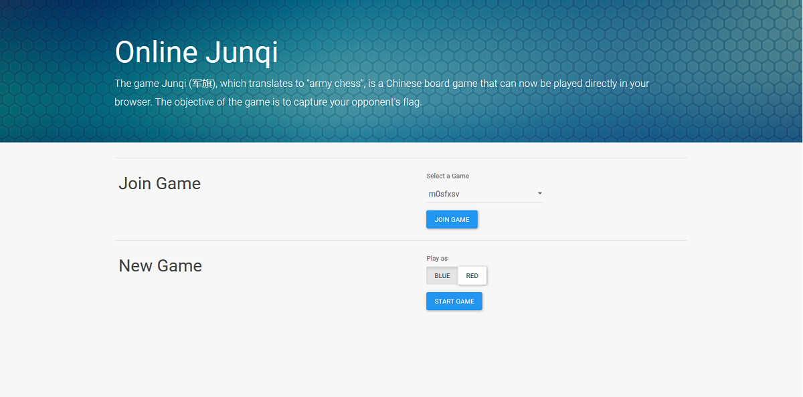
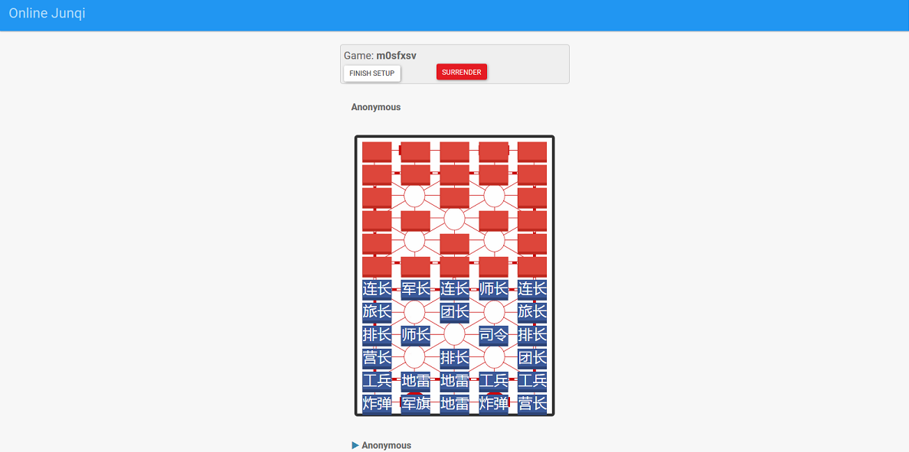

# online-junqi

An open source Junqi app that can be played directly in your browser. This app was developed with Node.js and Websockets.

For a more detailed version of the game's rules, you can refer to [this page](https://en.wikipedia.org/wiki/Luzhanqi).

<div style="display:inline-block;">


</div>

## How to Play

Create or join a game → set up your pieces → swap two of your own pieces by clicking each square in turn → take turns moving/attacking → capture the opponent's flag to win.

Piece ranking, highest to lowest (higher rank captures lower, equal ranks trade):

司令 (Commander) > 军长 (General) > 师长 (Major General) > 旅长 (Brigadier General) > 团长 (Colonel) > 营长 (Major) > 连长 (Captain) > 排长 (Lieutenant) > 工兵 (Engineer)

Special pieces:
* 炸弹 (Bomb) — destroys itself and whatever it attacks or is attacked by
* 地雷 (Landmine) — immobile; beats every piece except the Engineer
* 军旗 (Flag) — immobile; loses to any piece, and capturing it wins the game

Getting Started
---

1. Clone the project

2. Install npm dependencies
```
cd online-junqi
npm install
```

3. Compile Typescript
```
npm run build
```

4. Run nodejs
```
npm run start
```

5. Visit localhost:3000 to view the page.

Unit Tests
---

Run unit tests
```
npm run test
```

Run unit tests with a coverage summary printed to the terminal.
```
npm run test:coverage
```
